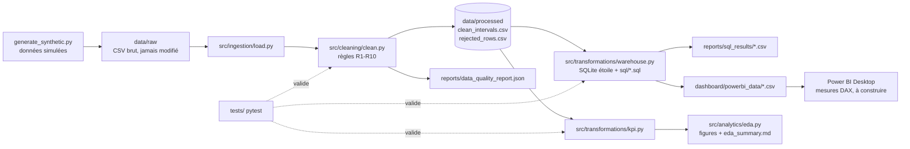
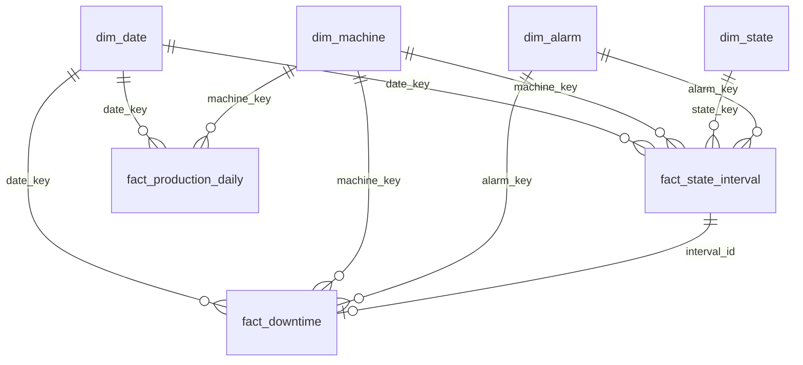

# Architecture

Orchestration : `python -m src.pipeline` (≈ 5 s sur 18 000 lignes).

## Modèle en étoile

`fact_production_daily` et `fact_downtime` sont dérivés de `fact_state_interval` par `sql/transformations.sql`.

## Choix techniques

* **SQLite** plutôt que PostgreSQL : zéro installation, reproductible en CI ; schéma portable (voir en-tête de `sql/schema.sql`). PostgreSQL non exécuté.
* **Pas de Docker** : une seule dépendance runtime (Python + 3 bibliothèques), Docker n'apporterait pas de reproductibilité supplémentaire ici.
* **CSV** plutôt que Parquet : évite une dépendance (`pyarrow`) pour 3 Mo de données.
