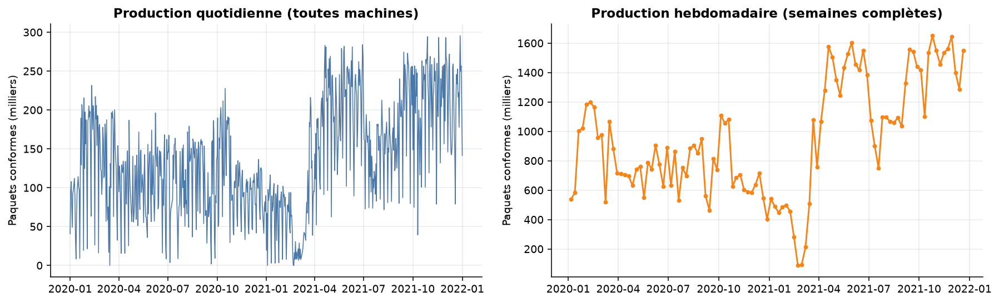
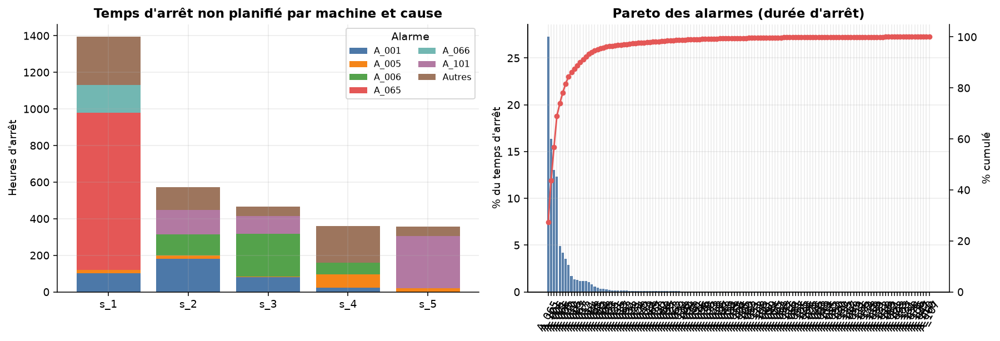
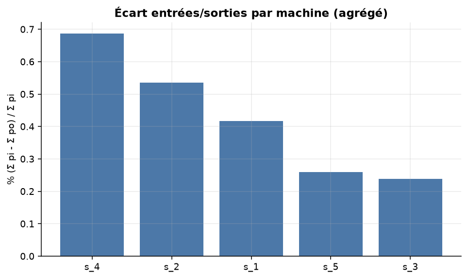
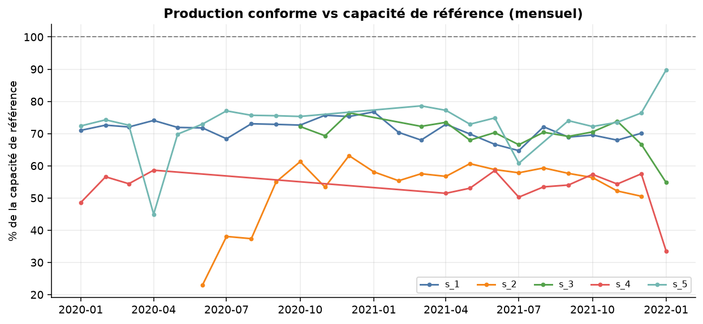
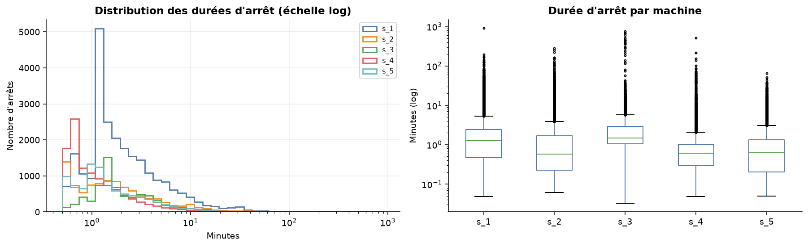
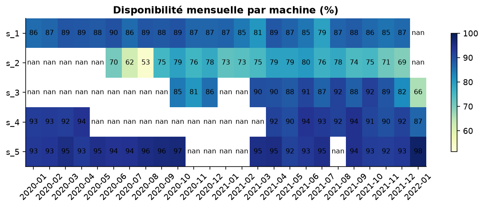
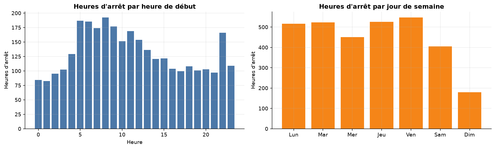

# Analyse exploratoire — résultats commentés

> Chiffres générés automatiquement par `src/analytics/eda.py` à partir des données nettoyées.

## Évolution de la production (jour / semaine)

- **Question métier** : La production totale est-elle stable dans le temps ? Y a-t-il des ruptures ?
- **Méthode** : Somme des paquets de sortie (po) par jour de début d'intervalle, puis par semaine (lundi). Semaines partielles exclues du panneau de droite.
- **Résultat observé** : Production hebdomadaire moyenne : 945,076 paquets (min 88,042, max 1,650,957) ; coefficient de variation 41.3%.
- **Limites** : Somme des 5 machines (vitesses nominales différentes) ; un intervalle à cheval sur minuit est rattaché à son jour de début ; aucune notion de commande ou de demande.

## Arrêts par machine et par cause

- **Question métier** : Quelles machines et quelles alarmes concentrent le temps d'arrêt non planifié ?
- **Méthode** : Somme des durées des intervalles d'état 'downtime' par machine x alarme ; Pareto sur la durée totale par alarme.
- **Résultat observé** : s_1 concentre 44.3% des heures d'arrêt (1,393 h). L'alarme A_065 pèse 27.3% du temps d'arrêt ; 7 alarmes sur 132 cumulent au moins 80 %.
- **Limites** : La durée dépend du codage des alarmes (une alarme = cause déclarée, pas forcément cause racine). Les arrêts 'UNKNOWN' sont des alarmes manquantes imputées par la règle R8.

## Écart entrées/sorties par machine

- **Question métier** : Quelles machines affichent le plus grand écart entre paquets entrés et sortis ?
- **Méthode** : Sur compteurs cumulés différenciés (convention : variation attribuée à la ligne courante), écart = Σ max(pi - po) agrégé par machine / Σ pi. Calculé UNIQUEMENT à l'agrégat.
- **Résultat observé** : Écart par machine : s_4 0.69%, s_2 0.53%, s_1 0.42%, s_5 0.26%, s_3 0.24%.
- **Limites** : ⚠️ Ce n'est PAS un taux de rebut démontré : po dépasse pi sur ~15 % des lignes (décalage de comptage), les arrêts reçoivent un résidu d'environ 50 paquets, et la définition exacte de pi/po n'est pas vérifiée. Les unités de comptage ne sont pas forcément comparables entre machines. L'analyse « après un arrêt » est volontairement absente : non fiable sur ces compteurs.

## Production réelle vs capacité de référence

- **Question métier** : Quel écart entre la production conforme et ce que la machine produirait à sa vitesse nominale pendant son temps de charge ?
- **Méthode** : Capacité de référence = vitesse nominale (P95 empirique de la vitesse en production) x heures de charge (marche + arrêts non planifiés). Rapport = po / capacité.
- **Résultat observé** : Taux de réalisation moyen par machine : s_1 71.3%, s_2 55.6%, s_3 70.2%, s_4 54.4%, s_5 73.9%.
- **Limites** : ⚠️ La capacité de référence est DÉRIVÉE des données, ce n'est PAS un objectif de production fourni : le dataset ne contient aucune cible. Un taux < 100 % est attendu par construction (P95).

## Distribution des durées d'arrêt

- **Question métier** : Les pertes viennent-elles de nombreux micro-arrêts ou de quelques arrêts très longs ?
- **Méthode** : Histogramme en échelle logarithmique par machine et boîtes à moustaches.
- **Résultat observé** : Durée médiane 0.9 min, P95 7 min ; les 5 % d'arrêts les plus longs représentent 43.2% du temps d'arrêt total. Médiane par machine : s_1 1 min, s_2 1 min, s_3 1 min, s_4 1 min, s_5 1 min.
- **Limites** : Distribution très asymétrique : privilégier médiane/quantiles à la moyenne. Les arrêts signalés par la règle R10 sont conservés et pèsent dans la queue.

## Disponibilité par mois et machine

- **Question métier** : Quelles machines et quelles périodes affichent une disponibilité dégradée ?
- **Méthode** : Disponibilité = heures de marche / (heures de marche + heures d'arrêt non planifié). Idle et arrêts programmés exclus du temps de charge.
- **Résultat observé** : Valeur la plus basse : s_2 en 2020-08 (53.4 %).
- **Limites** : Dépend de la convention : idle = manque de charge (exclu). Si l'idle masquait des pannes non déclarées, la disponibilité serait surestimée. Mois partiel de début/fin à interpréter avec prudence.

## Profil horaire et hebdomadaire des arrêts

- **Question métier** : Existe-t-il des créneaux (équipe, jour) qui concentrent les arrêts ?
- **Méthode** : Somme des heures d'arrêt selon l'heure et le jour de la semaine du début de l'arrêt.
- **Résultat observé** : Pic à 8 h (1.47 x la moyenne horaire) ; jour le plus chargé : Ven.
- **Limites** : Les équipes ne figurent pas dans les données : l'heure n'est qu'un proxy d'équipe. Un écart faible peut être du bruit d'échantillonnage ; pas de test statistique d'hétérogénéité ici.
